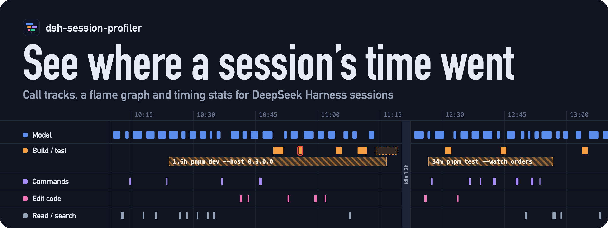
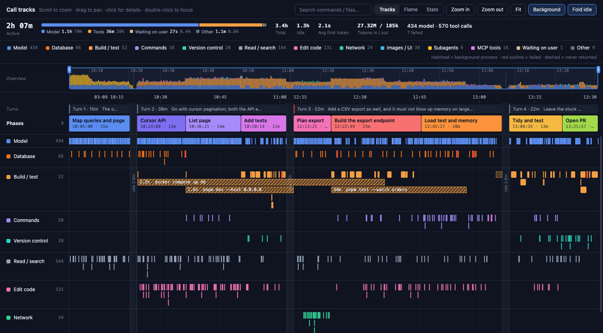

# dsh-session-profiler

English | [简体中文](README.zh-CN.md)

Turns a [DeepSeek Harness](https://github.com/deepseek-ai/deepseek-harness) (dsh) session into a timeline: **call tracks** in one lane per category, a **flame graph** and **timing statistics**, so you can see whether the time went to the model, to tools, or to waiting on a person.



Once installed, every session gets a **Profiler** tab in its tab bar (to the right of Trajectory).

## What you get

- **Tracks**: one swim lane per category (Model, Build / test, Commands, Version control, Read / search, Edit code, Network, Images / UI, Subagents, MCP tools, Waiting on user, Other). Calls that overlap are stacked on separate rows.
- **Flame**: laid out by nesting depth — steps → model and tool calls → sub-calls and background processes.
- **Stats**: count, total, average, longest and failures per category and per tool, plus the 20 slowest calls (click a row to jump back to the tracks and locate it).
- **Overview**: a strip at the very top showing how busy each category was across the whole session, with its own time scale. The lit window is the range the chart below is showing.
- **Turns and phases**: two rows under the time axis. Phases come from the session's todo list — whichever item is "in progress" owns that stretch of time. A turn without todos is titled with its prompt.
- **Time breakdown**: time inside turns is split into Model / Tools / Waiting on user / Other, which add up to the active time. Total duration, idle time, average time to first token and token counts are shown alongside.
- **Segments inside a model call**: time to first token, reasoning, answer, and tool-call arguments, taken from the timestamped stream in the log.
- **Background processes** (hatched): processes started with `run_in_background` that keep running after the tool call returns, drawn until they actually finish.
- **Failures** (red outline), **calls with no result event** (dashed — for example when the turn was aborted), and **running** calls (they keep growing in a live session).
- **Fold idle**: gaps of more than a minute between turns collapse into a narrow band; otherwise a session spread over several days is nothing but a few thin lines.

Controls: scroll to zoom (scrolling over the label column on the left scrolls the lanes instead), drag to pan, click for details (arguments and results load on demand), double-click to focus on a call, phase or turn, drag the window in the overview strip to pan or its side handles to change the range, and use the search box to highlight by command or file name. Keyboard: `+` `-` zoom, `0` fit, arrow keys pan, `Esc` clears the selection.

A running session refreshes on its own, and only the changes are transferred.

## Install

Requires dsh `>= 0.2.2-rc.1` (verified on 0.2.2-rc.1).

```bash
git clone https://github.com/jkzing/dsh-session-profiler.git && cd dsh-session-profiler
pnpm install         # also builds lib/
dsh plugin --profile web add .
```

Then restart `dsh web`. To uninstall:

```bash
dsh plugin --profile web remove dsh-session-profiler
```

## Custom lanes

The built-in categories are generic. For a lane specific to your project (say, database commands on a lane of their own), add this to the profile's `cordis.patch.yml` (`~/.dsh/profiles/web/cordis.patch.yml`):

```yaml
- update:
    - id: dsh-session-profiler
      config:
        categories:
          - id: database
            label: Database
            color: '#f97316'
            match: '\b(psql|mysql|prisma)\b'
```

`match` is a regular expression (case-insensitive) tested against `"<tool name> <one-line description>"` — for `bash` the description is the command itself. The first rule that matches, top to bottom, wins and takes precedence over the built-in categories. A malformed rule is skipped with a warning in the dsh log.

## How it works

```
src/shared   pure functions from events to timeline data (shared by the host, the tests and the offline script)
src/host     host half: two POST routes that read session events and fold them into timeline data
src/client   browser half: the tab, the canvas charts, the stats tables and the detail panel
```

- The host half subscribes to no events and writes nothing to the session log. Each request reads the committed events through `sessionQuery.observeSession` — from memory for a live session, from storage for a cold one.
- `POST api/dsh-session-profiler/timeline { sessionId, since? }` returns the whole timeline, or the spans that changed since `since` (a span's id depends only on the log prefix, so merging increments is deterministic).
- `POST api/dsh-session-profiler/span { sessionId, seq }` returns one span's arguments and result, fetched only on click.
- The browser half registers into the `conversation.view` slot. While this tab is showing, the conversation's input box gets out of the way (unless an approval or a plan review is pending).

Events used: `turn/*`, `step/*`, `assistant/message`, `assistant/attempt`, `tool/call`, `tool/result`, `tool/ptc-dispatch*`, `job/registered`, `job/settled`, `approval/*`, `subagent/catalog`, `agent/inbox/spliced`, `todo/write`, `llm/retry-started`, `compaction/*`, `command/*`.

## Known limitations

- Background processes rely on `job/*` events. Sessions written by older versions of dsh don't have them, so a background command there shows up as one very short tool call.
- A subagent is drawn only as its start-to-finish span; the calls inside the child session are not expanded.
- Phases come from the todo list, with no semantic summarising. A session that doesn't use todos has one phase per turn.
- A forked session shows only its own part, not the history inherited from its parent.
- Rows per lane are capped (2 for the model, 5 for the rest); beyond that, parallel calls overlap on the same row.

## Development

```bash
pnpm check           # type check + tests + build
pnpm watch           # rebuild on change
pnpm preview         # a preview page that doesn't need dsh: http://127.0.0.1:4173/
```

The preview page drives the real host and browser code with a synthetic session (`scripts/demo-log.mjs`):

- `?session=demo` is a complete session of a bit over three hours; `?session=live` replays the same log in real time, for watching the polling
- `?view=flame|stats`, `?theme=light`, `?lang=en`
- `pnpm preview --lang en` writes the synthetic session itself in English (the screenshot above was taken this way)
- `pnpm preview ~/.dsh/sessions/<workspace>/<session>` loads a real session (needs the `zstd` command-line tool)

To fold a session into JSON offline:

```bash
pnpm timeline ~/.dsh/sessions/<workspace>/<session> --summary
```

To try it in a real dsh without touching your own profile, use a throwaway `DSH_HOME`:

```bash
DSH_HOME=/tmp/dsh-home dsh plugin --profile web add "$PWD"
```

```bash
DSH_HOME=/tmp/dsh-home dsh web --no-open --port 47311
```

## Releasing

Pushing a `v*` tag makes [publish.yml](.github/workflows/publish.yml) run `pnpm check` and publish to npm. Authentication uses npm trusted publishing; no token is stored in the repository.

```bash
pnpm version patch   # bumps the version, commits and adds the v tag; minor / major / an exact version work too
```

```bash
git push --follow-tags
```

Versions with a prerelease suffix (such as `0.2.0-rc.1`) are published to `next`, everything else to `latest`. Nothing is published when the tag and the version in `package.json` disagree.

## License

MIT
